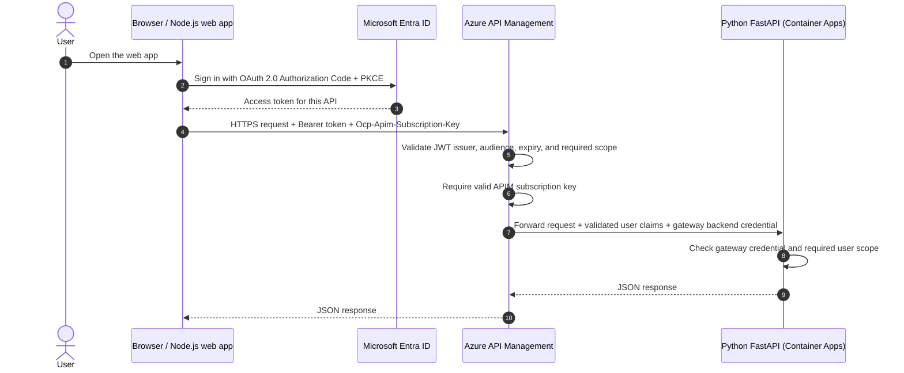
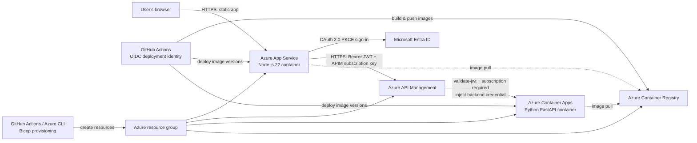

# Azure Node.js + Python API platform

A beginner-friendly reference project for a browser application and a Python API on Azure. The web application runs as a Node.js 22 custom container in Azure App Service. The API runs as a container in Azure Container Apps. Azure API Management (APIM) is the public API gateway between them.

## What you will build

- **Web client:** Node.js 22 + Vite + MSAL Browser. Azure App Service for Linux runs the Node container.
- **API:** Python 3.12 + FastAPI in Azure Container Apps.
- **Gateway:** Azure API Management exposes `/api/*`, validates Microsoft Entra access tokens, requires an APIM subscription, and forwards requests to the Python API.
- **Registry:** Azure Container Registry stores versioned images.
- **Infrastructure:** Bicep files create the Azure resources.
- **Delivery:** GitHub Actions builds and pushes both images, then updates the App Service and Container App. It signs into Azure using GitHub OIDC.

## Request flow



APIM performs both checks before forwarding. OAuth proves the caller's identity and permissions. The APIM subscription key identifies the calling subscription and enables quotas/rate limits; it is **not** a user credential. A browser is a public client, so any APIM key shipped to it can be read by its users. Use per-consumer keys, quotas, and OAuth scopes. For a production system that must keep the key private, put a Node.js backend-for-frontend (BFF) between the browser and APIM; the BFF can hold the key server-side and send the user's bearer token to APIM.

## Architecture



### Components

| Component | Responsibility |
|---|---|
| App Service | Hosts the Node.js 22 web UI in a Linux container and terminates public web traffic over HTTPS. |
| Microsoft Entra ID | Signs users in and issues an OAuth access token for the API. The sample uses the SPA authorization-code flow with PKCE. |
| API Management | Public API endpoint. Requires an APIM subscription key and validates Entra JWT signature, issuer, audience, lifetime, and `access_as_user` scope. |
| Container Apps | Runs the Python FastAPI service as a container with HTTP ingress. The starter uses external ingress so APIM can reach it without VNet setup; the API also checks a gateway-only shared credential. Restrict network access further for production. |
| Container Registry | Private storage for immutable, commit-tagged frontend and backend images. Azure managed identities pull the images. |
| GitHub Actions | Builds and deploys on pushes to `main`. OIDC avoids long-lived Azure client secrets. |
| Bicep | Describes the Azure resources as repeatable infrastructure-as-code. |

## Repository layout

```text
.
├── frontend/                 # Node.js 22 SPA and static web server
├── backend/                  # Python 3.12 FastAPI service
├── infra/                    # Bicep templates and APIM policy
├── scripts/                  # Local/deployment helpers
├── .github/workflows/        # CI and Azure deployment
├── docker-compose.yml        # Local development stack
└── README.md
```

## Run locally

Requirements: Docker Desktop or Docker Engine with Compose. Copy `.env.example` to `.env` and enter your Entra application values and a test APIM key if you have deployed the gateway. Do not commit local environment files.

```bash
docker compose up --build
```

Open <http://localhost:3000>. The frontend serves its SPA at port 3000 and the API directly at port 8000 for local development. For a full OAuth/APIM test, deploy the Azure resources and set `VITE_API_BASE_URL` to the APIM URL. The Python health check is available at `http://localhost:8000/health`.

## Entra ID setup

The Bicep template creates the Azure runtime resources, but app registrations are tenant-specific and require directory permissions. An administrator should:

1. Create an app registration for the API. Set its Application ID URI (for example `api://<api-client-id>`) and expose a delegated scope named `access_as_user`.
2. Create a **single-page application** registration for the frontend. Add the App Service URL (for example `https://<app-name>.azurewebsites.net`) as a redirect URI. Do not create a client secret for a SPA.
3. Add delegated permission to the API's `access_as_user` scope and grant consent as appropriate.
4. Set the frontend build variables `VITE_ENTRA_TENANT_ID`, `VITE_ENTRA_CLIENT_ID`, `VITE_ENTRA_API_SCOPE`, and `VITE_API_BASE_URL` in GitHub Actions variables (see below).
5. Set `ENTRA_TENANT_ID` and `ENTRA_API_AUDIENCE` in the Bicep parameter file. Use the exact audience emitted in the API token's `aud` claim (often the API client ID for v2 tokens; configure the template to match your registration).

The app uses the authorization-code flow with PKCE and requests an access token silently after sign-in. The browser token is never sent to the Node server; it is sent directly to APIM over HTTPS.

## Provision Azure resources

Install Azure CLI with the Container Apps and Bicep support, sign in, and select the target subscription. Names must be globally unique where Azure requires it. Choose a region that supports all selected SKUs. APIM Developer is suitable for learning and integration tests; it is not a production SLA tier and can have material hourly cost.

```bash
az login
az account set --subscription <subscription-id>
az group create --name rg-portfolio-api-dev --location centralindia
az deployment group create \
  --resource-group rg-portfolio-api-dev \
  --template-file infra/main.bicep \
  --parameters infra/dev.parameters.json \
  --parameters entraTenantId=<tenant-guid> entraApiAudience=<api-audience> \
  --parameters backendSharedKey=<long-random-secret>
```

For PowerShell, replace the backslash line continuations with backticks. Never commit real values into `dev.parameters.json`; it contains placeholders. Use Azure Key Vault or a secure deployment pipeline for secrets. Save the deployment outputs (`registryLoginServer`, `appServiceName`, `containerAppName`, `apimGatewayUrl`) for the GitHub setup. This starter uses a named APIM value for the gateway-to-backend credential. The backend checks the same value from its environment. Rotate it by updating both sides together.

After provisioning, configure these GitHub **Actions variables**:

| Variable | Value |
|---|---|
| `AZURE_CLIENT_ID` | Client ID of the federated GitHub deployment identity |
| `AZURE_TENANT_ID` | Microsoft Entra tenant ID |
| `AZURE_SUBSCRIPTION_ID` | Azure subscription ID |
| `AZURE_RESOURCE_GROUP` | Resource group created above |
| `ACR_NAME` | Registry name, without `.azurecr.io` |
| `APP_SERVICE_NAME` | App Service web app name |
| `CONTAINER_APP_NAME` | Container App name |
| `ENTRA_TENANT_ID` | Entra tenant ID for the SPA runtime config |
| `ENTRA_CLIENT_ID` | Frontend SPA application client ID |
| `ENTRA_API_SCOPE` | Full delegated scope, e.g. `api://<api-app-id>/access_as_user` |
| `APIM_API_BASE_URL` | APIM gateway URL plus API suffix, e.g. `https://<apim>.azure-api.net/demo` |
| `APIM_SUBSCRIPTION_KEY` (secret) | A disposable, rate-limited APIM subscription key for the browser demo |

Configure the OIDC federated credential to trust `repo:<owner>/<repo>:ref:refs/heads/main` with audience `api://AzureADTokenExchange`. Give that identity `AcrPush` on the registry and enough permission to update the two app resources. The workflow is a template and will fail until those values and the federated credential exist. The initial Bicep provisioning uses public placeholder images so the apps can be created before the first workflow pushes the actual images.

### APIM subscription key for the browser

Create a product in APIM, attach the `demo` API, and create a subscription for your test user/application. Set its primary or secondary key as the GitHub Actions secret `APIM_SUBSCRIPTION_KEY`; the deployment workflow writes it as an App Service setting, and the web server makes it available to the SPA via `/runtime-config.json`. Since the browser can read it, use a disposable, low-privilege subscription with strict rate limits. Do not use an administrator or master key. In production, use the BFF pattern described above, or issue a separate subscription per consumer and accept that browser users can inspect their own key.

## API endpoints

| Method | Path | Purpose | Auth |
|---|---|---|---|
| `GET` | `/health` | Liveness/readiness probe | None |
| `GET` | `/api/v1/hello` | Example protected response with caller claims | Entra scope + APIM key + APIM-to-backend credential |

## Useful commands

```bash
# API docs for local development
python -m venv .venv
pip install -r backend/requirements.txt
uvicorn backend.app.main:app --reload --port 8000

# Build each image locally
docker build -t apim-demo-frontend:local ./frontend
docker build -t apim-demo-backend:local ./backend

# View Azure resources
az resource list --resource-group rg-portfolio-api-dev --output table
```

## Security and production checklist

- Require HTTPS and a real OAuth access token; never accept an ID token as an API access token.
- Keep scopes and audiences narrow. The sample policy checks Entra issuer, API audience, and `access_as_user` scope.
- APIM subscription keys are shared bearer values. Rotate them, use least-privilege products, and apply rate limits. Do not mistake them for user authentication.
- The sample's browser subscription key is visible to every user. Use a BFF if the key must remain secret.
- The sample Container App uses public ingress, protected by a shared gateway credential as a defense in depth. A production deployment should use private networking so only APIM can reach the API, and should consider managed identity/private endpoints.
- Set the same high-entropy backend credential in APIM's named value and the backend container secret. Do not put it in source control, logs, or frontend configuration.
- Use Key Vault references/managed identity for runtime secrets, add WAF and rate limits as needed, and enable diagnostic logs/alerts.
- Pin and regularly update base images and GitHub Actions; use image scanning and Azure Policy before production.
- Choose a supported APIM tier and network topology for your traffic, availability, and cost requirements. The Developer tier is non-production.

## Troubleshooting

- **401 from APIM:** check the `Authorization: Bearer` header, token issuer, `aud` value, expiry, and delegated `scp` claim. Ensure the browser requested the API scope rather than only a Microsoft Graph scope.
- **403 or subscription error:** ensure the API is attached to the product and the request uses the product subscription key in `Ocp-Apim-Subscription-Key`.
- **502 from APIM:** verify the Container App URL and `/api/v1/hello` backend path, ingress status, and backend shared credential named value.
- **App Service won't start:** confirm the image listens on port 8080 and `WEBSITES_PORT=8080` is set.
- **CORS error:** allow the exact App Service origin in APIM CORS policy. Do not use `*` with credentials.
- **GitHub workflow cannot log in:** check all three Azure IDs, `id-token: write`, federated subject (`repo:owner/name:ref:refs/heads/main`), and Azure role assignments.

## References

- [Deploy a custom container to App Service with GitHub Actions](https://learn.microsoft.com/en-us/azure/app-service/deploy-container-github-action)
- [Configure OAuth 2.0 and JWT validation in APIM](https://learn.microsoft.com/en-us/azure/api-management/api-management-howto-oauth2)
- [Validate JWT policy reference](https://learn.microsoft.com/en-us/azure/api-management/validate-jwt-policy)
- [GitHub Actions for Azure Container Apps](https://learn.microsoft.com/en-us/azure/container-apps/github-actions)
